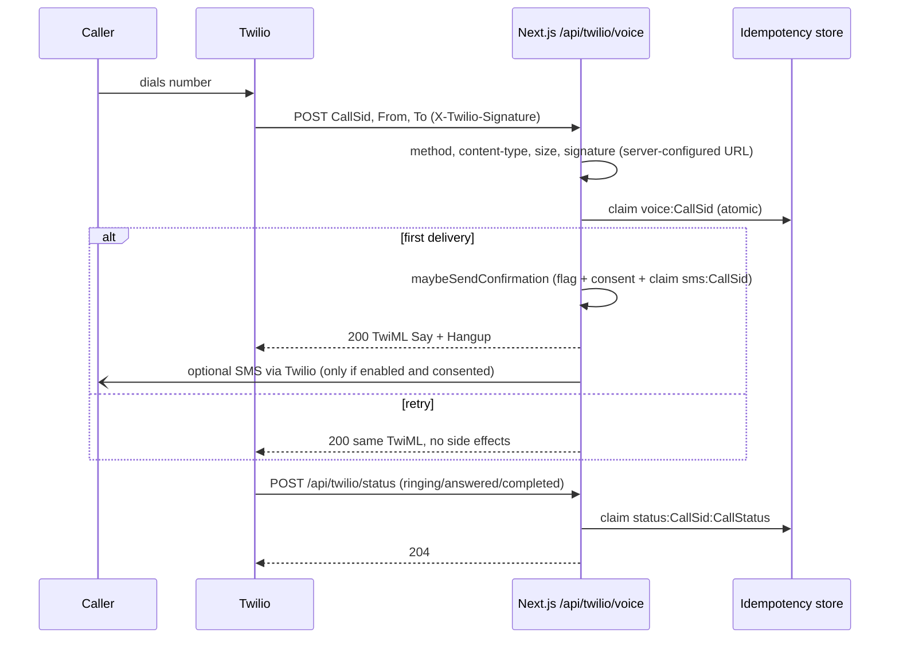

# Telephony Webhooks Lab

## 1. Event sequence


## 2. Procedure
```bash
git checkout -b feature/telephony-webhooks
cp .env.example .env.local          # fill locally; never paste into shell history
npm install && npm test             # fixtures first, before any tunnel
npm run dev
# simulator (no paid account): sign + replay the fixture twice
PUBLIC_BASE_URL=http://localhost:3000 TWILIO_AUTH_TOKEN=local_dummy npm run simulate
```
Set the same `TWILIO_AUTH_TOKEN` and `PUBLIC_BASE_URL` in the server env as in the simulator command.
Expected: attempt 1 and 2 both return 200 TwiML; the event log shows `received` then `duplicate`.

Live run (only if permitted): start a tunnel, set `PUBLIC_BASE_URL` to the exact HTTPS origin, set the Twilio number's Voice URL (POST) to `<origin>/api/twilio/voice` and Status Callback to `<origin>/api/twilio/status`. Call only from an approved test number. Set `SMS_ENABLED=true` and add one verified, consenting recipient to `SMS_CONSENT_NUMBERS`. Keep tokens out of screenshots; rotate if exposed.

## 3. Threat model: one test per threat
| Threat | Mitigation | Test |
|---|---|---|
| Forged request | HMAC-SHA1 check of `X-Twilio-Signature` with `TWILIO_AUTH_TOKEN` | invalid / missing signature |
| Wrong-URL / Host-header spoofing | URL built from `PUBLIC_BASE_URL`, not request | signature for different URL |
| Body tampering | Signature covers params | tampered body |
| Replay / retry | Atomic claim on `CallSid` (+`CallStatus`) | duplicate, concurrent retries |
| Double SMS | Separate `sms:<CallSid>` claim, flag, consent allow-list | duplicate, flag off, no consent |
| PII leakage in logs | Allow-listed fields, `***last4` | logs contain no full phone/token/sig |
| Oversized / odd requests | 405, 415, 413, 400 | request hygiene tests |
| Dead line on failure | Fallback TwiML, HTTP 200 | store outage |
| Provider outage | SMS failure isolated from call | SMS failure test |
| Flooding | **Not implemented**: add edge/IP rate limiting (e.g. platform WAF or Upstash ratelimit) | gap, see Extension |

Known caveat: replay of a *captured, validly signed* request is only stopped by idempotency within the claim TTL. Twilio signatures carry no timestamp.

## 4. Reconciliation
Take one `CallSid` from the app log, find it in Twilio Console > Monitor > Logs > Calls, and confirm the status sequence and SMS (if any) match. Record the SID here: `______`.

## 5. AI Collaboration Checkpoint (fill in yourself)
Prompt used: "Threat-model this webhook handler. Focus on signature verification, replay, idempotency, logging, PII minimization, rate limits, and safe error responses. Return one test per threat."
| Tool | Useful output | Rejected output + why | How verified | Commit |
|---|---|---|---|---|
| ChatGPT | | | | |
| Gemini | | | | |
Do not paste secrets or real numbers into either tool.

## 6. Verification checklist
- [x] Invalid signatures rejected (403)
- [x] Duplicate events create no duplicate message
- [x] Logs contain no full phone numbers, recordings, or tokens
- [x] Simulator path works without paid service (tests + `npm run simulate`)

## Troubleshooting
Signature mismatch: check scheme/host/path/trailing slash against `PUBLIC_BASE_URL`, and that nothing rewrites the form body. Test fixtures before debugging the tunnel.

## Extension
Dead-letter table for `sms:failed` / `error` outcomes with a retry dashboard; swap `MemoryStore` for Redis/Postgres (comments in `lib/idempotency.ts`); add rate limiting.
